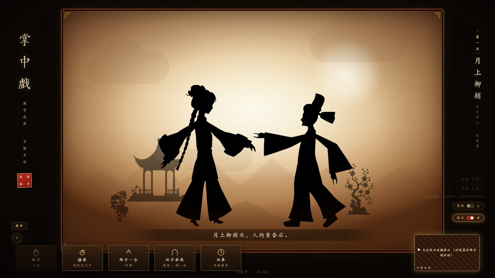
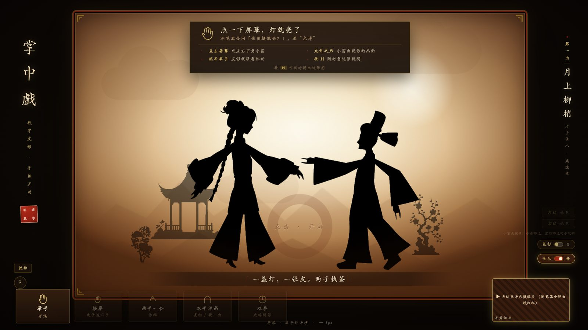
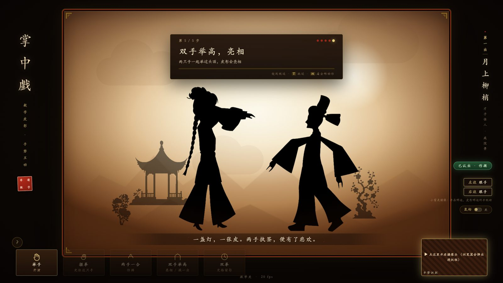
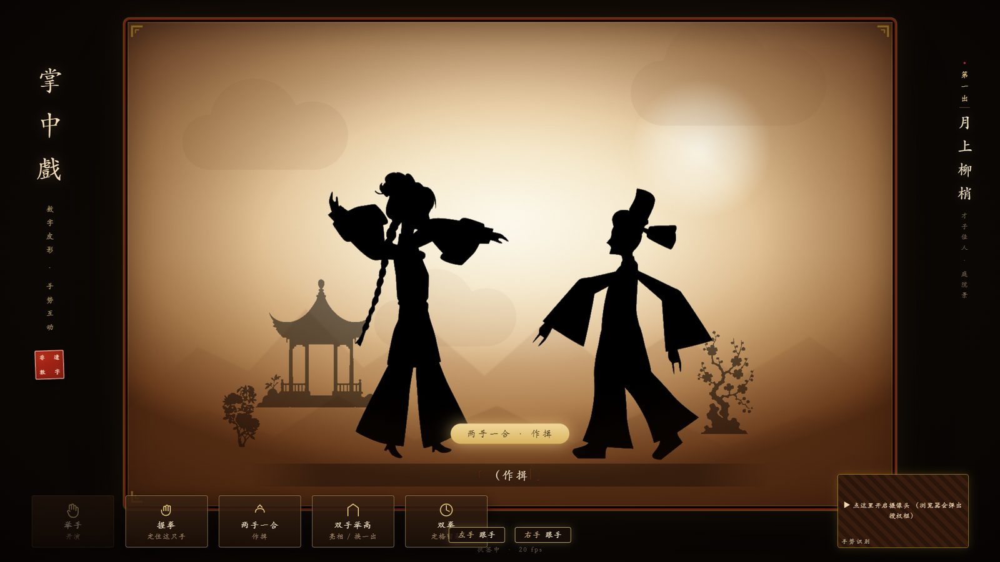
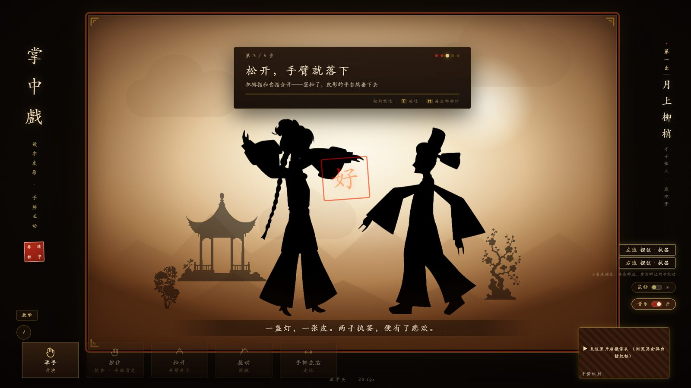
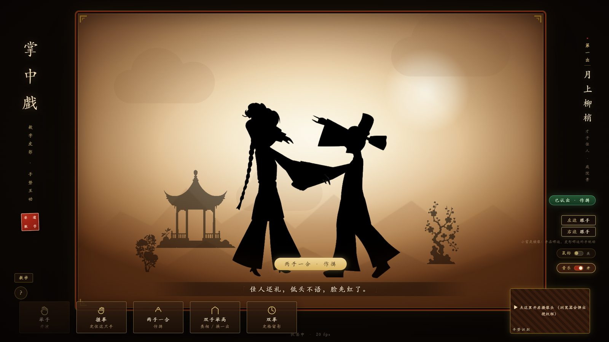
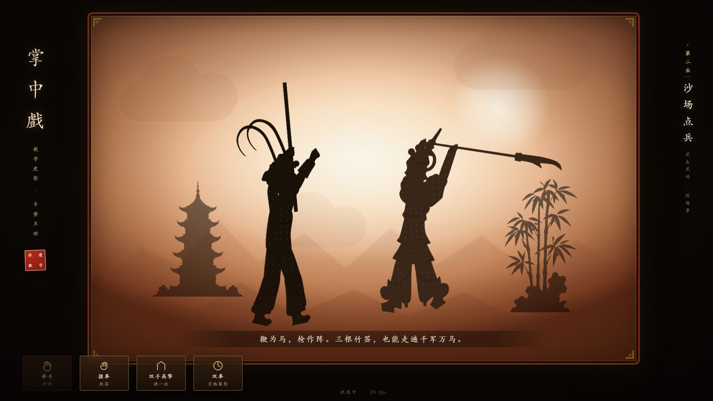
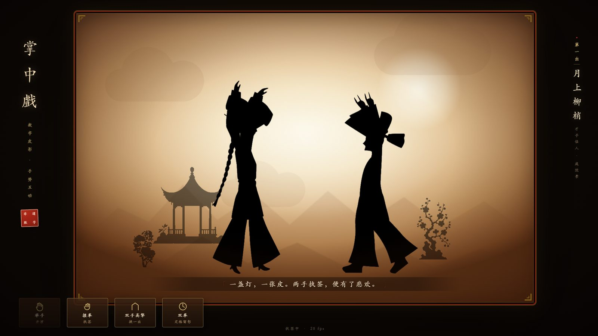
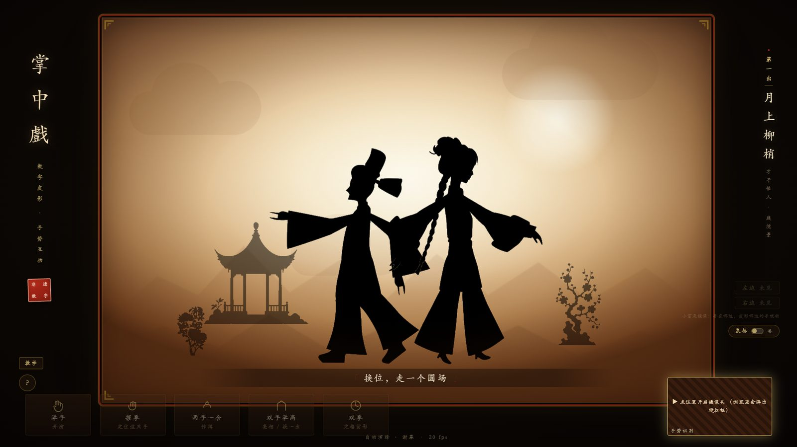

# 掌中戲 · 手势皮影（Shadow Play Kiosk）

**在线演示**：https://jonhate.github.io/shadow-play/ 　**源码**：https://github.com/jonhate/shadow-play

> 在线版首次加载要下约 20MB（手势模型 + wasm + 皮影资产），家宽大约 10–20 秒；展馆现场请用本地部署（见 `docs/部署与开源.md`）。
> 摄像头需要 HTTPS 或 localhost，线上版与本地版都满足。

一个能直接跑的**数字皮影互动展项原型**：摄像头看见你，你举起双手，皮影戏台上的皮影就跟着你抬手、落手、行走、亮相。

- 内容：Woooo Piying Lab 官方资产库的 `.woop` 皮影包（翎冠武生、持戟武将、长辫女子、骑鹤仙人……）
- 手势：Google **MediaPipe Gesture Recognizer**（21 点手部关键点 + 手势分类，单模型）
- 渲染：**three.js** 正交相机 + 逐部件仿射矩阵（真实还原皮影"分件 + 关节 + 竹签"的结构）
- 界面：灯箱影幕、剪纸红金、竖排题名、朱印落款



| | |
| --- | --- |
|  |  |
| 待机：引导卡 + 点一下开摄像头 | 教学关：每一步做对才过 |
|  |  |
| 剧情节拍：动作推着台词走 | 手指模式：捏住 = 执签 |
|  |  |
| 左右手各控一个皮影，横移带动走位 | 三档皮之一：镂空 |
|  |  |
| 双人同台 | 六幕演完自动谢幕 |


---

## 1. 跑起来
### 最省事：双击桌面上的「掌中戏 · 手势皮影」

那个快捷方式做三件事：没服务器就起一个（隐藏窗口，日志写 `server.log`）→ 等它就绪 → 用 Edge 打开页面。
关掉浏览器不会停服务器；下次再双击，它检测到端口已开就直接开浏览器。

命令行等价物：

```bat
启动掌中戏.cmd            :: 普通窗口（开发/调试用这个）
启动掌中戏.cmd kiosk      :: 全屏展馆模式：藏鼠标、禁右键
启动掌中戏.cmd duo        :: 双人同台
```

底层是 `tools\launch.ps1`（`-Mode kiosk|duo`、`-NoOpen` 只起服务不开浏览器）。

### 手动跑（控制台里看日志）

```bash
cd piying/shadow-play
node tools/serve.mjs
# 打开 http://127.0.0.1:5173/
```

> 摄像头需要 **localhost 或 https** 环境，所以必须用这个本地服务器打开，不能双击 `index.html`。
>
> 端口被占用时会自动顺延到 5174/5175…，看第一行 ASCII 提示里的 URL 就行。

无摄像头也能演示：

```
http://127.0.0.1:5173/?manual=1
```

键鼠模式：移动鼠标 → 双手位置；`空格` → 握拳/张手；`1/2/3` → 切出目；`N` → 下一出；`F` → 定格留影；`C` → 摄像头小窗；`M` → 切换键鼠/摄像头；`K` → **换皮**（剪影 → 镂空 → 套色）。

其他开关：`?skin=carved|painted|silhouette` 指定皮肤，`?scene=2` 从指定出目开始，`?duo=1` **双人同台**（见下）。

### 摄像头是怎么申请的（重要，别以为是坏了）

**页面加载时不会申请摄像头。** 因为浏览器对「没有用户手势的摄像头申请」经常直接静默拒绝——不弹窗、也不报错，表现就是“压根没要授权”。

正确流程是：

```
打开页面 → 右下角小窗闪着金框「▶ 点这里开启摄像头」
        → 观众点一下屏幕（或点小窗）
        → 浏览器弹出「是否允许使用摄像头」→ 选「允许」
        → 小窗出现实时画面，引导卡切成「张手移动 / 握拳执签…」
```

- 点屏幕**任意位置**都会触发申请，不用非得点那个小窗；
- 申请失败后连续两次就不再每次点击都弹，改成点小窗或按 `R` 重试；
- 全程状态都写在小窗里，不会出现“什么都没发生”；
- **摄像头还没起来时，动鼠标就能先玩**（自动切到鼠标兜底），不会让展项看起来是死的。

### 摄像头打不开？先跑自检页

```
http://127.0.0.1:5173/camtest.html
```

这一页会告诉你四件事，**不需要懂技术也能看**：

1. 环境对不对（安全上下文、有没有 `mediaDevices`）；
2. 浏览器给的**权限状态**（已授权 / 已拒绝 / 未决定）；
3. 系统里**到底有没有摄像头设备**（几个、叫什么）；
4. 真正打开一次，成功就给分辨率和帧率，失败就给**错误码**。

失败时按错误码对照（页面里也写了）：

| 错误码 | 说明 | 怎么办 |
| --- | --- | --- |
| `NotAllowedError` | 浏览器或系统不允许 | Windows 设置 → 隐私和安全性 → 摄像头 → 打开「摄像头访问」+「允许桌面应用访问摄像头」；再点地址栏左侧摄像头图标允许本站 |
| `NotFoundError` | 系统没看到设备 | 查 USB / 排线 / 设备管理器里的「照相机」/ 笔记本的物理遮挡开关 |
| `NotReadableError` | 被别的程序占用 | 关掉腾讯会议、OBS、相机 App、部分安全软件 |
| `OverconstrainedError` | 不支持请求的分辨率 | 自检页会自动降级重试 |
| `SecurityError` | 不是 https / 127.0.0.1 | 别用 `file://` 双击打开 |

### 手势语义

| 手势 | 效果 |
| --- | --- |
| 张手移动 | 皮影的对应那只手跟着你的手走 |
| **握拳**（单手） | **执签：那只手定在原地不动**（不是掉下来） |
| 双手举高 | 换一出戏 |
| 双手握拳 | 定格留影（落印拍一张） |

> 皮影手和你的手是**镜像**对应的：你抬左手，屏幕上皮影的左手（画面上偏右那只）抬起。

### 动作库（10 个）

| 动作 | 怎么比 | 皮影怎么演 |
| --- | --- | --- |
| 跟手 | 张手移动 | 那只手跟着你走，走快了会自己迈步 |
| **定住**（执签） | 握拳 | 那只手停在原地不动，再张手继续跟 |
| **作揖** | 两手一合、掌心相对 | 双臂收回胸前、上身微躬 —— **剧情靠它推进** |
| **亮相** | 双手举过头顶 | 双臂高举、抬头；举满 2.5 秒换下一出 |
| **甩袖** | 双手**同向快速横扫**（半屏幅度、约半秒） | 手臂跟得更快，袖子甩起来 |
| **迈步** | 双手左右分开（各管一边）或一起平移 | 皮影跟着**手**走位，到台边自动转身 |

### 一只手管一个皮影（默认开启）

双手按画面左右分开时，**左边那只手管左边的皮影，右边那只手管右边的皮影**：

- 手往左挪 → 左边的皮影往左走；往右挪 → 往右走；回到中间它也站回中间；
- 每只手只驱动**同侧那一条手臂**，另一条自然垂落（和真人执签一致）；
- 握拳（或手指模式里松手）时这个皮影站住；
- 六幕演完的自动演绎、双人模式不受影响；
- 想回到"两只手都控主角"的旧玩法：`?split=0`。
| **定格留影** | 双手握拳 | 落印、拍一张白框照片 |
| 半开合 | 手型在拳掌之间 | 保持上一帧姿势，不乱跳 |
| 单手上举 | 一只手高于肩 | 对应手臂抬起 |
| 静止待机 | 没有手 | 双臂自然垂放 + 极轻的呼吸晃动 |

界面上右侧有 **左边 / 右边状态牌**（跟手 · 定住 · 半开 · 未见），随时能看出“这只手在听谁的”。
命名按**画面左右**走：手在小窗（镜像，像照镜子）的哪一边，就驱动舞台上同一边的那只手。

> **甩袖怎么才算做对**：两只手**朝同一个方向横向快甩**（像甩袖子），幅度至少半个画面、持续约半秒；
> 上下挥不算、一前一后不算、慢慢平移也不算（那是走位）。判定门槛是两手横向速度之和 > 0.8 画面宽/秒，
> 检测到后会保持 0.5 秒，屏幕提示变成绿色「✓ 已认出」就说明过了。

**认出动作会立刻告诉你**：屏幕右侧弹出绿色 `已认出 · 作揖`，剧情提示条会变成

```
✓ 已认出：两手一合 · 作揖      ← 绿底打勾
```

也就是“做对了”是看得见的，不用猜。

### 教学关（第一次来会先过一遍）

摄像头接通后自动进入 5 步教学，**每一步都要真的做出来才过**（进度条会涨）：

1. **举起一只手** —— 手掌张开，抬到胸前
2. **左右移动手掌** —— 横着平移一段（累计位移够才过，抖动不算）
3. **握拳，把它定住** —— 握紧拳头，看那只手停在原地（这就是“执签”）
4. **两手一合，作揖** —— 掌心相对靠到一拃宽（绿色「已认出 · 作揖」出现即算）
5. **双手举高，亮相** —— 两手一起举过头顶

过了就记住（`sessionStorage`，**关掉浏览器再开还会再教一遍**，适合展馆换观众）。
想随时重看：点**左下角「教学」按钮**，或按 `T`；`?tutorial=1` 也能强制进入；教学途中按 `T` 跳过。

### 六幕演完 → 自动演绎一段（谢幕）

把手势放下也没关系：六出戏轮完一遍后，会自己演一段约 24 秒的谢幕，不看手、不用人管：

| 时间 | 演什么 | 台词 |
| --- | --- | --- |
| 0–4s | 两位角儿上台站定 | 六出已尽 · 灯未灭，戏未散 |
| 4–8s | 对台下作揖 | 两位角儿，向台下作揖 |
| 8–12s | 亮相 | 亮相——一亮相，满堂彩 |
| 12–16s | 交叉换位（圆场） | 换位，走一个圆场 |
| 16–20s | 再拜谢幕 | 再拜，谢幕 |
| 20–24s | 退场，回到待客 | 一盏灯，一张皮，谢谢观看 |

演完自动回到待客状态、从第一出重新开始。想单独看一遍：按 `P`。

### 引导卡什么时候出现

- **待客（没人玩）** 和 **第一次开摄像头后**：自动显示；
- 按 `H` 或点**左下角「?」按钮**：随时调出/收起（触摸屏也能用，不用记快捷键）；
- 教学关结束时：自动弹出 5 秒再收起；
- 换状态（回到待客）会把“手动收起”的重置掉，不会一次收起就再也不出现。

### 鼠标开关（不再自动兜底）

右下角摄像头小窗上面有个 **「鼠标 ○/●」** 开关：

- **关（默认）**：只认手势，动鼠标不会干扰皮影；
- **开**：鼠标立刻接管，移动鼠标 = 移动双手，空格 = 握拳/张手，方便没摄像头时演示；
- 摄像头一接通，会自动把鼠标开关关掉，交回给手势；
- 键盘 `M` 也能切换。

### 方案一：手指控制（进阶模式，`?finger=1` 或按 `G`）

依据传统握签方式（三根竹签的分工见 `docs/手指控制调研.md`）做的**进阶交互**：

| 你的手 | 皮影 |
| --- | --- |
| **拇指-食指捏合** | 这只手"夹住竹签"→ 皮影对应手臂**跟着握点走**（跟的就是拇指-食指中点，比掌心更贴近真签位） |
| 拇指与食指**分开** | 松开签 → 手臂自然垂落 |
| 拇指-食指连线**转动** | **转腕**（对应传统"搓签"技法） |
| 手挪到哪边 | 皮影整体往那边走（平衡杆） |

状态牌会显示 `捏住·执签 / 松开`。默认关闭（基础模式更稳），要体验开 `?finger=1` 或按 `G`。
阈值可调：`show.gripThreshold`（默认 0.55）、转腕幅度 `show.rollScale`（默认 0.55）。

> **手指模式下的全局动作**：作揖 = 两只手都捏住再靠拢（一拃宽）；亮相 = 捏住举高；
> 定格留影 = 双手握拳（手势分类仍然生效）。剧情提示文字会按模式切换，
> 手指模式下显示「两手捏住 · 靠近作揖」，不会误导成"两手一合"。

### 手指模式的教学关（和基础模式是两套）

切到手指模式会**自动进入 6 步教学**（也单独记在 sessionStorage，重开浏览器再教一遍）：

1. **把手放进画面** —— 先让小窗认出你的手
2. **拇指食指捏住** —— 像捏住一根竹签，皮影那只手就被签带起来
3. **松开** —— 签松了，手臂自然垂下去
4. **搓动转腕** —— 捏住的同时转一转拇指食指这条线（累计转角 0.7 弧度过）
5. **两手捏住，靠近作揖** —— 两只手都捏住再合到一拃宽，**剧情靠它推进**
6. **手挪到左右** —— 走位；回到中间就站住

底部提示条也会整排换成手指模式的动作（捏住 / 松开 / 搓动 / 手挪左右）。
重看：按 `T`（手指模式下）、点左下角「教学」按钮（按当前模式）。
另外右下角那排动作提示按 **当前模式** 自动切换，不会拿基础动作误导你。

> 现场没验证过的点：无名指/小指在单目 960×540 下抖动大，所以"拇指-小指"那根签的判定用的是**小指尖**而不是指组均值，灵敏度可能偏钝——用真机试完把 `gripThreshold` 告诉我。

### 剧情：六出戏，动作推着戏走

| 出目 | 角色 | 剧情推进动作 |
| --- | --- | --- |
| 月上柳梢 | 长辫女子 · 乌帽书生 | 作揖 ×2 |
| 沙场点兵 | 翎冠武生 · 持戟武将 | 亮相 → 甩袖 |
| 仙翁跨鹤 | 骑鹤仙人 · 鹿 | 举高腾云 |
| **西厢 · 月下相会** | 乌帽书生 · 长辫女子 | 作揖 → 作揖 → 举高 |
| **霸王别姬** | 持戟武将 · 长辫女子 | 作揖 → 举高 → 甩袖 |
| **八仙 · 过海** | 骑鹤仙人 · 龙 | 举高 → 甩袖 |

台词会一句一句走；遇到需要动作的节拍，屏幕下方会浮出一枚金色提示（例：「两手一合 · 作揖」），
做对了（保持 0.45 秒）才继续下一句，**一次动作只推进一步**（不松手不会连跳）。

> 改编说明：角色是用现有皮影资产组的“近似行当”（书生配旦角），属于**意向性改编**，
> 不是传统剧本的完整复原；正式展陈建议请非遗传承人核一遍唱词与身段。

### 验收 / 排障用的两个开关

```
?debug=1   左下角浮出诊断面板，实时显示摄像头状态、模型后端、推理耗时、识别到几只手
?still=1   皮影完全静止（默认有很轻的待机晃动，用来做对照/拍定妆照）
```

诊断面板长这样：

```
URL      : ?debug=1
camera   : off  err=NotAllowedError      ← 没开起来；也可能显示 waiting-click（还没点屏幕）
model    : ready  delegate=GPU           ← GPU/CPU 后端
inference: 18 ms/frame                   ← 单帧推理耗时
hands    : 2  P0Left(1.92) P0Right(1.88) ← 识别到的手 + 张开度
mode     : gesture  duo=false
skin     : silhouette
state    : play  scene=月上柳梢
puppets  : 2  view=1580x1000
render   : 60 fps
```

摄像头申请失败时，右下角预览窗会变成**斜纹底 + 红框**，直接把原因写在里面：

| 错误码 | 意思 | 怎么办 |
| --- | --- | --- |
| `NotAllowedError` | 浏览器把摄像头拒了 | 点地址栏左侧的摄像头图标 → 允许，然后**点预览窗重试** |
| `NotFoundError` | 没找到设备 | 检查摄像头插好没 |
| `NotReadableError` | 被别的程序占用 | 关掉腾讯会议/相机等再重试 |
| `TimeoutError` | 授权框弹了 30 秒没点 | 点预览窗重试，看到弹窗就点允许 |
| `SecurityError` | 不是安全上下文 | 必须用 `http://127.0.0.1` 或 `https`，不能 `file://` 打开 |

> 预览窗本身就是「重试」按钮，点一下会重新申请摄像头；按 `R` 也可以；按 `H` 随时调出完整手势说明。

> 关于待机晃动：皮影挂在竹签上本来就会轻轻晃，这是**故意**的（呼吸感）。如果不想要，`?still=1`；或者改 `puppet.js` 里 `Math.sin(t * 0.55) * 4` 的幅度。

### 上手引导

- **待客状态**：屏幕上方固定一张引导卡，写明「张手移动 / 握拳执签 / 双手举高换戏 / 双拳定格」；没有摄像头时自动换成鼠标版说明。
- **开演后**：引导卡收起，左下角保留 4 个动作提示卡（当前该做的那个会高亮）。
- **按 `H`**：随时调出/收起完整引导，馆里工作人员讲解时用得上。

展馆模式（藏鼠标、禁右键、出错自愈、点一下自动全屏）：

```
http://127.0.0.1:5173/?kiosk=1
```

双人同台（4 只手，左右各站一位观众，各控一个皮影）：

```
http://127.0.0.1:5173/?duo=1
```

> 双人模式把 MediaPipe 的 `numHands` 提到 4，推理开销约为单人的 1.6–2 倍。没有独显的机器建议先跑一遍看帧率，掉到 30fps 以下就退回单人。

---

## 2. 声音：六幕 BGM（程序合成）+ 台词语音（放 mp3）

### 六幕各一首 BGM

全部用 WebAudio **程序合成**，零素材、零版权，断网也能响（`app/audio.js` 的 `BGM` 表）：

| 出目 | 调式 | 速度 | 织体 |
| --- | --- | --- | --- |
| 月上柳梢 | 羽调（五声） | 62 | 拨弦分解 + 弱鼓，缠绵 |
| 沙场点兵 | 徵调偏低 | 116 | 密集战鼓 + 低音，硬朗 |
| 仙翁跨鹤 | 宫调 | 74 | 箫声颤音 + 混响，空灵 |
| 西厢 · 月下 | 商调 | 64 | 拨弦带铃，清雅 |
| 霸王别姬 | 角调 | 54 | 低沉长音 + 稀鼓，悲 |
| 八仙 · 过海 | 羽调明亮 | 102 | 快拨弦 + 板，热闹 |
| 谢幕 / 待客 | 羽调 / 宫调 | 58 / 50 | 长音铺底，收束 |

- 切出目自动换曲；回到待客换成安静的待客曲；自动演绎换成谢幕曲；
- `B` 键开关背景音乐（会记住选择，下次打开保持），`A` 键全局静音；
- 音量：`audio.bgmVolume(0.16)`（默认 0.16，控制台可调）。

### 用戏剧原声当 BGM（**已经接上了**）

现在的 `audio/bgm/` 里已经是你提供的 6 段原声（各裁 72 秒、响度归一 -18 LUFS、首尾淡入淡出）：

| 出目 | 用的曲子 | 文件 |
| --- | --- | --- |
| 月上柳梢 | 古琴《良宵引》（陈熙珵） | `moon.mp3` |
| 沙场点兵 | 民乐《将军令》 | `battle.mp3` |
| 仙翁跨鹤 | 古曲《万年欢》 | `crane.mp3` |
| 西厢 · 月下 | 昆曲《牡丹亭·游园》（昆鼓） | `xiang.mp3` |
| 霸王别姬 | 京剧曲牌《夜深沉》（燕守平） | `bawang.mp3` |
| 八仙 · 过海 | 关大洲《水龙吟》 | `baxian.mp3` |
| 谢幕 | 复用《万年欢》 | `curtain.mp3` |
| 待客（循环） | 复用《良宵引》 | `attract.mp3` |

**TTS 台词已自动关闭**：检测到有原声文件时不再念 AI 台词（两层人声会打架）。
想重新打开台词配音：`?voice=1`；强制关闭：`?voice=0`。

原声的处理方式：

- 整段循环，**淡入 1.8 秒**；换出目时**交叉淡化**（旧淡出 / 新淡入），不会硬切；
- 解码进内存，和台词同一条 WebAudio 通道，**不受自动播放策略影响**；
- `audio/bgm.json` 每首可单独调：`"offset": 42`（从第 42 秒开始循环）、`"gain": 0.8`（该曲音量系数）。

**换曲子**：把新的 mp3 丢进 `audio/bgm/`（同名覆盖）→ 跑一次 `node tools/export-lines.mjs`。

**从视频里抽音轨**（像这次一样拿到的是 mp4/mkv）：

```bash
python -m pip install imageio-ffmpeg   # 自带静态 ffmpeg，不用另装
python tools/extract-bgm.py            # 按文件名关键词匹配场景，裁 72 秒 + 归一响度
```

匹配关键词在脚本顶部 `RULES` 里改（`牡丹亭→xiang`、`将军令→battle`…）。

- 版权提醒：戏剧原声属于演出/录音版权方，商用展陈前请确认授权。

### 原声选曲建议（对应六出）

原则：**纯器乐曲牌 > 带唱段的**（不带唱词就不会和字幕打架），每幕 30–60 秒即可（页面会循环 + 交叉淡化）。

| 出目 | 建议找的曲牌/唱段 | 搜索关键词 |
| --- | --- | --- |
| 月上柳梢 | 京剧《小开门》慢板、碗碗腔文场曲牌 | 「京剧曲牌 小开门 纯音乐」「碗碗腔 文场」 |
| 沙场点兵 | 《将军令》《得胜令》《急急风》 | 「京剧曲牌 将军令 得胜令」 |
| 仙翁跨鹤 | 《万年欢》《朝天子》《水龙吟》 | 「京剧曲牌 万年欢 空灵」 |
| 西厢 · 月下 | 昆曲《西厢记·佳期》器乐段、《柳青娘》 | 「昆曲 西厢记 伴奏 曲牌」 |
| 霸王别姬 | **《夜深沉》**（梅派虞姬舞剑配乐，最贴） | 「夜深沉 京胡 大鼓」 |
| 八仙 · 过海 | 《水龙吟》《哪吒令》快板 | 「京剧曲牌 水龙吟 哪吒令」 |
| 谢幕 | 《万年欢》或《尾声》 | 「京剧曲牌 万年欢」 |
| 待客（循环） | 古琴《良宵引》《平沙落雁》 | 「古琴 良宵引」 |

素材来源三档：
1. **最推荐**：找当地皮影剧团/传承人要一段演出录音——授权最干净，也最有"非遗传承"的分量；
2. 视频平台（B 站/网易云）搜上表关键词，有大量练唱用纯音乐版本——**质量好但要谈授权**；
3. 免费可商用素材库（Pixabay Music、Free Music Archive 搜 `guzheng` / `erhu` / `chinese traditional`）——授权干净，但"原味"打折。

> 放好文件后跑 `node tools/export-lines.mjs`；原声带唱词就加 `?voice=0` 关台词配音。

### 动作音效（听得见的“做对了”）

认出动作时不只是弹绿色徽标，还给一记声音：

| 动作 | 音效 |
| --- | --- |
| 作揖 | 闷鼓 + 板 |
| 亮相 | 锣 |
| 甩袖 | 三板连击 |
| 执签（握拳） | 轻板一声 |
| 定格留影 | 大锣 |

### 台词语音（你说的 AI 合成）

页面会按固定命名去取音频，**有就播、没有就静音跳过**，不会报错：

```
audio/lines/<场景id>/<两位序号>.mp3
   audio/lines/moon/01.mp3     ← 月上柳梢 第 1 句
   audio/lines/xiang/03.mp3    ← 西厢 第 3 句
   audio/lines/curtain/02.mp3  ← 谢幕 第 2 句
```

生成台词表 + 目录骨架：

```bash
node tools/export-lines.mjs
# → audio/lines.json          （清单）
# → docs/台词表.md            （31 句：场景 / 句号 / 需要做的动作 / 台词 / 文件名）
# → audio/lines/{moon,battle,crane,xiang,bawang,baxian,curtain}/
```

`docs/台词表.md` 里有 edge-tts 的一行命令示例，照着批量生成即可。
装好 `pip install edge-tts` 之后也可以直接跑脚本，它会把 31 句全生成好并刷新清单：

```powershell
powershell -ExecutionPolicy Bypass -File tools\make-voice.ps1
```

每个出目默认用不同音色（女声 Xiaoxiao / 男声 Yunxi / 浑厚 Yunjian），要换改脚本里的 `$voices`。

念台词时 BGM 会自动压低到 30%（ducking），念完 0.5 秒恢复；换出目/回待客会立刻掐掉上一句。

> **为什么之前听不到台词？** 旧版台词走 `<audio>` 元素，由游戏事件触发，而浏览器的自动播放策略会**静默拦截**这种"没有用户手势的播放"——背景音乐走 WebAudio（在第一次点击时解锁过）所以能响，台词就被拦了。现在台词也走 WebAudio（解码进内存播放），和音乐同一条通道，**只要点过一次页面就一定有声**。

### 音频自检页

```
http://127.0.0.1:5173/audiotest.html
```

- 顶部状态：AudioContext 是否 running、31 句是否全部解码进内存、缺哪些文件；
- 六幕 BGM 每首一个按钮，点了切换、再点停；
- 31 句台词逐句 ▶ 试听；
- 底部电平条实时跳动——**没声音的时候它一动不动，一眼就能看出问题**。

### 音乐开关

右下角摄像头小窗上面有两个开关：**鼠标** 和 **音乐**。
嫌合成 BGM 不好听，直接点「音乐」关掉（会记住），等你放真曲子再打开。
清单里标着每句是否「已就绪」，**没生成 mp3 的句子直接跳过，不会在控制台刷 404**。

---

## 3. 交互设计

皮影戏真正的操作是**三根竹签**：一根撑头颈身，两根挑双手。这里把它映射成最直觉的动作：

| 观众动作 | 皮影反应 |
| --- | --- |
| 举手（掌心朝镜头） | 唤醒，3-2-1 开演 |
| 张开手左右移动 | 皮影的两只手跟着走（双骨 IK），移动越快皮影走步越快 |
| 握拳 | **执签**：这只手停住不动，皮影的手就定在那里 |
| 双手同时举过头 | 换一出戏（换景片 + 换角儿） |
| 双手同时握拳 1 秒 | **定格留影**：落朱印，拍下当前画面 |
| 离开镜头 6 秒 | 收幕，回到待客的吸引循环 |

握拳=执签、张手=放手 这个映射不是随便定的：它和真人操作竹签的手感一致，观众第一次上手通常 3 秒内就能自己发现，不需要文字教学，所以现场只放了四个图标提示。

### 三档皮（同一个骨架换皮肤）

| 皮 | 效果 | 怎么切 |
| --- | --- | --- |
| **纯剪影**（默认） | 黑色皮影 + 暖色背光幕布，最接近传统影窗 | `K` 循环 / `?skin=silhouette` |
| **剪影 · 镂空** | 剪影上带程序化雕刻孔，背光从孔里透出来，像真皮影 | `K` / `?skin=carved` |
| **套色彩绘** | 按角色染色：朱红身、石绿袖、墨蓝腿、赭石脸手，衣袍上同样有雕刻孔 | `K` / `?skin=painted`（旧参数 `?paint=1` 仍可用） |

原理：官方资产的部件图是**纯黑剪影**（RGB 全 0），直接乘颜色还是黑。所以染色/镂空材质在 shader 里**把贴图只当 alpha 用**，RGB 交给材质颜色，再在“部件像素空间”里生成纹样（`puppet.js` 的 `paintMaterial`）：

```glsl
vec2 pp = vMapUv * uSize;                       // 部件自己的像素坐标，不随缩放变形
float dotGrid = abs(sin(pp.x*.055)) * abs(sin(pp.y*.055));
float holes = smoothstep(.93, .999, dotGrid);   // 一排排小孔
maskA *= mix(1.0, 1.0 - uCarve, holes);         // 抠掉 => 背光透出来
diffuseColor.rgb *= mix(1.0, 1.0 - uInk, ink);  // 云纹/刀口压暗
```

脸和手只留极淡的纹（`uHoles ≈ 0.1`），衣袍才打孔——否则整张脸像筛子。

三套皮肤（原贴图 / 套色 / 剪影镂空）在 `Puppet` 构造时就全部建好，切换只是换 `mesh.material`，不重建贴图、不掉帧。

### 对戏 / 双人

| 场景 | 谁控谁 | 怎么开 |
| --- | --- | --- |
| **单人 · 对戏** | 对手（持戟武将）**照着你反着来**：你抬手他就挡，像在接招。把手部目标做水平镜像后喂给对手的 IK，不需要第二套识别 | 默认（第二出） |
| **双人 · 同台** | 两位观众**各控一个皮影**。4 只手按画面横向顺序分组：最左两只 → 观众 A，最右两只 → 观众 B；各自控自己那个皮影的两条臂 | `?duo=1` |

双人的分组逻辑在 `gesture.js` 里：手按镜像后的 x 排序，`i < 2` 归 A、否则归 B，并带上 `player` / `side` 字段；`show.js` 的 `gatherInput()` 按 player 归组后分别喂给 `lead` 和 `support`。

无摄像头时想演示双人：`?duo=1&manual=1`，第二双手会镜像第一双（只是用来验证链路，不是真双人）。

---

## 4. 目录结构

```
shadow-play/
├── index.html            展项界面（灯箱、题名、字幕、提示、留影）
├── styles.css            非遗风格视觉：剪纸红金 / 灯箱 / 竖排 / 印章
├── app/
│   ├── main.js           启动、加载进度、键鼠兜底、kiosk 模式
│   ├── woop.js           .woop 解析器（zip → 部件贴图 + 骨架数据）
│   ├── rig.js            2D 仿射（A）、关节链、双骨 IK、姿态求解（纯数学、可单测）
│   ├── puppet.js         一个皮影：three 网格、逐帧贴矩阵、走步循环、竹签
│   ├── stage.js          舞台：正交相机、景片、皮影、自适应
│   ├── gesture.js        MediaPipe 封装：平滑、左右手分配、张开度/捏合度
│   ├── show.js           剧目状态机：待客 → 开演 → 执签 → 定格 → 收幕
│   ├── ui.js             DOM 绑定：字幕逐字、印章、留影、关键点预览
│   └── audio.js          合成锣/鼓/梆子 + 六幕 BGM + 台词语音（零音频素材）
├── puppets/              15 个 .woop 资产 + index.json
├── models/               gesture_recognizer.task（8.2MB）
├── audio/                音频：lines/<场景>/NN.mp3 台词配音（可空），lines.json 清单
├── docs/台词表.md         配台词用：31 句 + 文件名（tools/export-lines.mjs 生成）
├── assets/app.ico        桌面快捷方式图标（tools/make-icon.py 生成）
├── 启动掌中戏.cmd         一键启动（桌面快捷方式指向它背后的 launch.ps1）
├── camtest.html          摄像头自检页
├── vendor/               three.js / fflate / mediapipe tasks-vision + wasm（全离线）
└── tools/
    ├── serve.mjs         静态服务器（端口占用自动顺延）
    ├── launch.ps1        启动器：起服务 → 等就绪 → 开浏览器（-Mode kiosk|duo，-NoOpen）
    ├── export-lines.mjs  导出台词表 + 生成配音目录骨架
    ├── extract-bgm.py    从 mp4/mkv 抽音轨 → 裁段 + 响度归一 → audio/bgm/*.mp3
    ├── start-kiosk.cmd      全屏展馆 · 单人版
    ├── start-kiosk-duo.cmd  全屏展馆 · 双人版
    ├── make-icon.py      生成 assets/app.ico
    ├── cdp-shot.mjs      无头浏览器截图自测（CDP，含页面报错捕获）
    ├── render-rig.mjs    离线把骨架姿态导出，配合 render-pose.py 出图验证
    └── sync/             重新下载资产/模型/依赖的脚本
```

依赖全部**本地化**，断网也能跑，不需要 npm install。

---

## 5. `.woop` 资产格式（实测）

`.woop` 就是一个 zip：

```
woop.json                     # schemaVersion / parts / joints / partAssets / rigSemantics
parts/part_001/00.webp        # 每个部件的贴图（带 alpha）
references/*.webp             # 装配参考图
```

关键字段：

```jsonc
{
  "parts": [{
    "id": "part_004",
    "width": 252, "height": 528,
    "rest": { "matrix": [1,0,0,1,726,729], "zIndex": 7 },  // 仿射 6 元组，rest 是装配姿态
    "anchors": [{ "id": "anchor_001_a", "partPx": [62, 40] }]  // 关节锚点（部件内像素坐标）
  }],
  "joints": [{
    "id": "joint_001",
    "parent": { "partId": "part_004", "anchorId": "anchor_001_a" },
    "child":  { "partId": "part_005", "anchorId": "anchor_001_b" }
  }],
  "rigSemantics": { "roles": { "head": "part_005", "leftUpperArm": "part_010", ... } }
}
```

坐标系是 **X 右 / Y 下**。`rig.js` 的做法：

1. 每个部件 = 一个单位四边形 + 它的 `rest` 仿射矩阵；
2. 关节把 `parent.anchor` 和 `child.anchor` 焊在一起（误差 > 0.01px 时自动缝合，避免关节开裂）；
3. 姿态求解：`T_child = T_parent ∘ Rotate(枢轴, θ)`，最终 `世界矩阵 = T ∘ rest`；
4. `rigSemantics.roles` 指明哪件是头/上臂/小臂/手/腿——有它才能做 IK；缺 roles 时退回按关节树深度猜。

> 因此**给馆里换新皮影只要丢一个新的 `.woop` 进 `puppets/` 并改 `index.json`**，不需要重新绑骨。

---

## 6. 为什么是这个组合（选型说明）

| 方案 | 结论 |
| --- | --- |
| **MediaPipe Gesture Recognizer**（选中） | Google 官方、持续维护、单个 `.task` 同时给 21 点关键点和手势分类；浏览器 wasm 直接跑，GPU delegate 走 WebGL；官方文档 / Android / Web / Python 多端一致 |
| MediaPipe Hands（旧） | 只有关键点，手势要自己分类；已被 Tasks 版取代 |
| Handsfree.js | 封装友好但维护节奏慢，底层仍是 MediaPipe，多一层依赖 |
| TFJS handpose | 精度和速度都弱于 MediaPipe |
| Leap Motion / Ultraleap | 需要专用硬件，博物馆加一套成本和故障点，不划算 |
| Blender 实时渲染 + 传感器 | 要开着编辑器，现场运维不可接受（见下） |

> `models/` 里还放了 `hand_landmarker.task`：如果只想拿 21 点、自己做手势逻辑，把 `gesture.js` 里的 `GestureRecognizer` 换成 `HandLandmarker` 即可，骨骼驱动那一层完全不用改。

**为什么不用 Blender 实时**：Woooo 的 Blender 插件是**创作端**——导 `.woop`、调骨骼、加灯箱、做渲染。展馆现场要的是"通电即演、崩溃自愈、无人值守"，所以运行时选浏览器：同一套资产，用 three.js 复刻灯箱的背光剪影观感。Blender 留在内容生产环节（出新角儿、调倾斜/灯箱滤镜）。

**Blender 的渲染和网页的观感差距**：插件里有真实透射材质、景深、辉光；网页里用"暖色背光渐变 + 幕布噪点 + 暗角 + 剪影投影"近似，成本低、帧率稳。要更接近，可以按 `docs/展项方案.md` 里的"进阶路线"接一次离屏渲染。

---

## 7. 自测

无头浏览器截图（需要本机有 Edge）：

```bash
node tools/serve.mjs                     # 另开一个终端
node tools/cdp-shot.mjs                  # 输出 shots/01..05
node tools/cdp-shot.mjs "http://127.0.0.1:5173/"   # 摄像头链路（无摄像头会退回键鼠）
```

骨架数学单独验证（不依赖浏览器）：

```bash
node tools/render-rig.mjs                # 导出 shots/rig/pose.json
python tools/render-pose.py              # 用 Pillow 合成 pose-rest.png / pose-hands.png
```

`shots/rig/pose-hands.png` 就是"双手抬起"这个 IK 目标的离线渲染结果，用来确认关节不出错位。

### 这一轮修掉的三个真 bug（都做过量化验证）

| # | 症状 | 原因 | 修法 | 验证 |
| --- | --- | --- | --- | --- |
| 1 | 手臂“不跟手”，怎么动都只走一点点 | 每帧先把关节角清零，阻尼再从 0 开始算，手臂永远只到 IK 解的 23% | 记住上一帧角度，阻尼基于上一帧 | 跟随角从 0.434 → **1.855**（满解），30/60/180 帧收敛一致 |
| 2 | 皮影一直“一颤一颤” | 手部关键点噪声被放大；且手臂顶到 100% 臂展（IK 奇异点）时目标抖 1px 角度甩十几度 | 目标点指数逼近+死区、关节角二次阻尼、只用到 94% 臂展、手型判断加滞回 | 稳态抖动标准差 **1.6°（关呼吸）/ 2.8°（含刻意呼吸）** |
| 3 | 握拳时皮影手“掉下去”，和指引说的“执签定住”相反 | 握拳只是清掉目标，走了下垂分支 | 新增 held 语义：记住握拳那一刻的姿势并保持 | 目标被拉走 900px 后角度 1.8554 → **1.8516**（只差呼吸的 0.004） |

另外把摄像头改为「点击后申请」：浏览器对没有用户手势的 `getUserMedia` 会静默拒绝，所以加载时申请等于什么都没发生。

---

## 8. 已知限制 / 下一步

- **资产是纯剪影**：官方库里每个部件是黑色 alpha 剪影（灯箱观感很好），没有内部雕花。`K` 键的套色模式只是按角色给整件上色，做不出传统皮影的镂空线纹；要真正的"彩绘皮影"，最好请 Woooo 出彩色 `.woop`（格式不变，代码零改动）。
- **双人是"左右分人"**：靠画面横向顺序把手分给 A/B，两位观众**换位/交叉手**时身份会互换。真机验收时让两人站定、别交叉手臂即可；要更稳可以加一个"谁先出现谁当 A"的粘滞策略。
- **音效是合成的**：现场建议换成真实锣鼓/碗碗腔采样（`audio.js` 里换成 `AudioBufferSourceNode` 即可）。
- **留影**只落地成 PNG，馆方若要扫码带走，需要在 `capturePhoto()` 后接一个上传/二维码服务。

---

## 9. 工具面板（给不懂技术的人用）

屏幕左下角有一排按钮：**教学 / ? / 工具**。点「工具」会弹出面板，里面把原来需要记 URL 参数的东西全变成了按钮：

| 按钮 | 作用 |
| --- | --- |
| 摄像头自检 | 打开 `camtest.html`：权限状态、设备列表、错误码、逐级降级重试 |
| 音频自检 | 打开 `audiotest.html`：31 句台词逐句试听 + 六幕 BGM 试听 + 电平条 |
| 诊断面板 | 当场开关实时面板（帧率、识别手数、推理耗时、摄像头状态），不用改地址栏 |
| 全屏显示 | 浏览器没自动全屏时手动切 |
| 展馆模式 | 跳转到 `?kiosk=1`：藏鼠标、禁右键、出错自愈 |
| 双人同台 | 跳转到 `?duo=1`：两位观众各控一个皮影 |
| 手指模式 | 当场切换捏合执签 / 搓动转腕，并自动放对应的教学关 |
| 重看教学关 | 按当前模式放一遍五步教学 |
| 使用说明 | 屏幕上那张动作总表（等同按 `H`） |
| 清除记忆 | 清掉教学进度与开关状态，恢复出厂并重载 |

跳转类按钮会把参数写进地址栏，所以配置好之后**直接收藏/建快捷方式**即可。

---

## 10. 许可证

代码以 **MIT** 发布，见 `LICENSE`。
素材（皮影 `.woop`、戏剧原声）已获授权用于本项目，第三方使用前请自行确认权利归属；
`vendor/` 内的 three.js(MIT)、fflate(MIT)、MediaPipe(Apache-2.0) 各自遵循原许可证。

